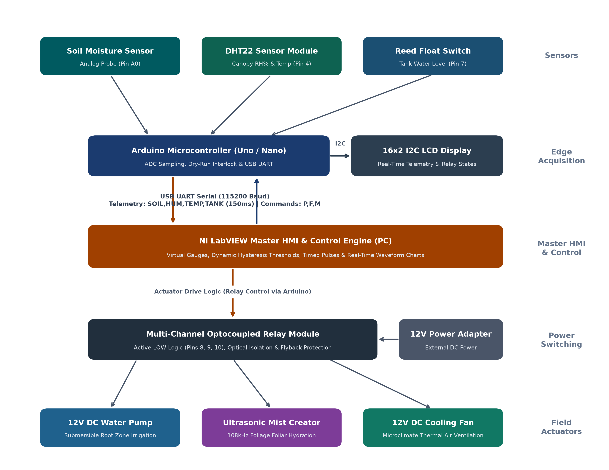
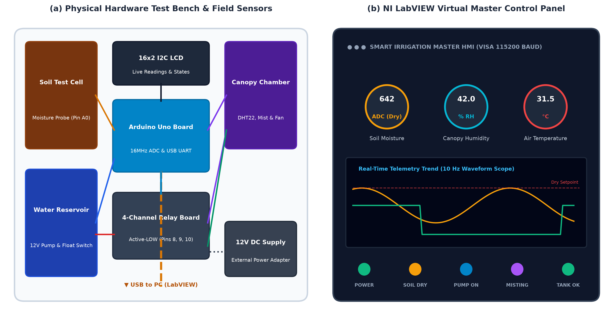

# PROJECT REPORT
## CONTROL SYSTEMS & INDUSTRIAL AUTOMATION

# Smart Automatic Irrigation, Misting & Thermal Cooling System
### *An Arduino & NI LabVIEW-Interfaced Agricultural Automation Controller*

**SLOT:** F2+TF2  

**DONE BY:**
* **Hitesh V S (25BEE1165)**
* **Vijay Varshan P (25BEE1148)**
* **Adithya K S (25BEE1101)**

---

## Abstract
This project presents an intelligent, multi-zone agricultural climate and irrigation controller that regulates root soil moisture, foliage canopy humidity, and microclimate air temperature through an integrated Arduino and NI LabVIEW-interfaced architecture. The physical system measures root soil moisture resistance via an analog probe (Pin A0), ambient temperature and canopy relative humidity via a digital DHT22 sensor (Pin 4), and storage tank water level via a magnetic float switch (Pin 7). An Arduino microcontroller acquires sensor signals, updates a local 16x2 I2C LCD display, and streams real-time formatted telemetry strings (`SOIL,HUM,TEMP,TANK\n`) every 150ms over USB UART serial communication at 115200 baud to a National Instruments (NI) LabVIEW Master Human-Machine Interface (HMI) on a PC. 

LabVIEW serves as the master supervisory controller: it renders live virtual gauges and thermometers, enforces software-defined hysteresis deadbands to eliminate rapid relay chattering and contact bounce, logs sensor waveforms at 10Hz, and executes automated decision logic. Compact command strings (`P,F,M\n`) are transmitted back to the Arduino to drive an optocoupled relay module controlling a 12V DC submersible water pump for root irrigation, an ultrasonic mist creator for foliar hydration, and a 12V DC cooling fan for thermal air circulation. An embedded dry-run safety interlock immediately disables the pump and mist relays upon water depletion, preventing pump burnout. The system ensures robust 24/7 automated greenhouse climate control, energy efficiency, and precise water conservation.

**Keywords:** Automatic Irrigation, Arduino, NI LabVIEW, USB Serial Telemetry, HMI Virtual Instruments, Dry-Run Protection, Ultrasonic Misting, DHT22 Sensor, Soil Moisture Control.

---

## Objectives
* To continuously monitor root zone soil moisture, foliage canopy relative humidity, and ambient temperature in real time.
* To interface Arduino hardware with NI LabVIEW Master HMI via high-speed USB UART serial communication at 115200 baud.
* To eliminate rapid relay and pump motor chattering around moisture setpoints using software-defined hysteresis deadbands in LabVIEW.
* To deliver calibrated, timed irrigation cycles for root watering and foliar misting to prevent soil oversaturation and surface pooling.
* To implement a fail-safe dry-run protection interlock using a magnetic reed float switch to prevent submersible pump motor burnout.
* To regulate crop foliar transpiration and canopy temperature using 108kHz ultrasonic piezoelectric mist creators and a 12V DC cooling fan.
* To provide an interactive virtual control panel with dial gauges, real-time waveform charts, diagnostic LEDs, and manual override switches.

---

## Existing Methods
Traditional agricultural irrigation relies predominantly on periodic manual inspection and mechanical ball-valve scheduling, which is labor-intensive, imprecise, and incapable of responding to rapid environmental fluctuations. Commercial agricultural timer systems deliver water according to rigid, pre-programmed clock schedules regardless of actual soil moisture conditions, frequently resulting in over-irrigation, nutrient leaching, or severe root rot (Gupta et al., 2019, IEEE Access). Industrial SCADA architectures provide closed-loop control but require expensive PLCs and proprietary telemetry, making them cost-prohibitive for small greenhouses (Kumar et al., 2021, International Journal of Engineering Research). Basic microcontroller prototypes utilizing single-threshold comparator modules without hysteresis suffer from severe relay chattering when moisture hovers near the trigger setpoint, leading to contact welding and pump motor winding failure (Sharma et al., 2020, Computers and Electronics in Agriculture). Furthermore, conventional standalone systems lack PC-based supervisory visualization, historical waveform logging, and dry-run pump interlocks.

---

## Limitations of Existing Methods
* Manual inspection cannot provide continuous or real-time soil moisture and climate tracking.
* Fixed-schedule timers lead to massive water wastage during rain and crop dehydration during drought.
* Single-threshold comparators lack hysteresis, causing severe relay contact chattering and electrical arcing.
* Microcontroller-only irrigation systems lack intuitive visual dashboards, data logging, and interactive operator controls.
* Absence of water reservoir interlocks leads to pump dry-running, cavitation, and motor thermal burnout.
* Most existing prototypes monitor only soil moisture, completely ignoring foliar canopy humidity and thermal stress.
* Industrial SCADA systems are cost-prohibitive and overly complex for small-to-medium greenhouse polyhouses.

---

## Proposed Methodology
The proposed architecture implements a distributed edge-acquisition and master supervisory control pipeline. At the edge layer, an Arduino microcontroller interfaces directly with three field sensors: an analog resistive soil moisture probe connected to analog Pin A0, a digital DHT22 relative humidity and temperature sensor on digital Pin 4, and a magnetic reed float switch on digital Pin 7 configured with internal pull-up. The Arduino samples the sensors every 150ms, formats the data into a comma-delimited telemetry packet (`SOIL,HUM,TEMP,TANK`), updates an onboard 16x2 I2C LCD display locally, and streams the packet over USB UART at 115200 baud to an NI LabVIEW Virtual Instrument on the host PC. 

In LabVIEW, NI VISA reads the serial stream, parses the numeric values, and displays them on virtual gauges, thermometers, and a 10Hz multi-trace waveform scope. Software hysteresis algorithms in LabVIEW compare soil moisture, humidity, and temperature against operator-adjustable setpoint sliders (with configurable deadbands), generating relay commands that completely eliminate contact chattering. LabVIEW transmits compact actuation commands (`P,F,M`) back to the Arduino, which drives an optocoupled multi-channel relay module to switch a 12V DC water pump, ultrasonic mist creator, and 12V cooling fan. A firmware-level dry-run safety interlock immediately overrides pump and mist commands if the reservoir is depleted, guaranteeing pump safety.

### Block Diagram :

---

## Hardware Components Used

| S.No | Component Name | Specification | Purpose |
|:---:|:---|:---|:---|
| 1 | Arduino Microcontroller | Uno / Nano (ATmega328P, 16MHz) | Sensor ADC sampling, dry-run safety logic, local I2C LCD, and USB UART serial telemetry |
| 2 | Soil Moisture Sensor Module | Resistive Probe Module | Measures root zone soil moisture resistance and outputs analog voltage to Pin A0 |
| 3 | Temp & Humidity Sensor | DHT22 (AM2302) Digital Module | Measures foliage canopy relative humidity (10-90% RH) and air temperature (0-60°C) via Pin 4 |
| 4 | Water Tank Float Switch | Magnetic Reed Float Switch | Reservoir level detection; triggers dry-run pump cutoff via Pin 7 (INPUT_PULLUP) |
| 5 | Multi-Channel Relay Module | 4-Channel Optocoupled 5V Relay | Active-LOW power switching for 12V DC pump, mist creator, and cooling fan (Pins 8, 9, 10) |
| 6 | Submersible Water Pump | 12V DC 3W Mini Pump | Root zone irrigation actuator delivering water from storage reservoir to soil roots |
| 7 | Ultrasonic Mist Creator | 108kHz Piezoelectric Atomizer Disc | Micro-fine foliar hydration misting directly to plant canopy leaves above soil |
| 8 | Small Cooling Fan | 12V 0.15A Brushless DC Fan | Thermal microclimate ventilation and air circulation during high ambient temperature |
| 9 | 16x2 Character LCD | RG1602A with I2C Backpack (0x27) | Local real-time alphanumeric display of soil, humidity, temperature, and relay states |
| 10 | DC Power Adapter | 12V DC 2A Regulated Supply | External power supply delivering stable DC power for 12V pump, fan, mist, and relays |
| 11 | USB Interface Cable | USB Type-A to Type-B Cable | High-speed bidirectional UART serial communication between Arduino and host PC LabVIEW |

---

## Implementation

### Step-by-step procedure:
* Soil moisture sensor probe is connected to Arduino analog input Pin A0 and powered from the Arduino 5V regulated rail.
* DHT22 digital temperature and humidity sensor data line is connected to Arduino digital Pin 4.
* Magnetic reed float switch is mounted in the water reservoir and wired between Pin 7 and GND with internal pull-up enabled.
* 16x2 character LCD with I2C backpack is connected to Arduino I2C bus (SDA to Pin A4, SCL to Pin A5, Address 0x27).
* Optocoupled 4-channel relay module inputs are connected to Arduino digital Pins 8 (Pump), 9 (Fan), and 10 (Mist).
* 12V DC submersible water pump, ultrasonic mist creator, and 12V cooling fan are wired to relay normally-open (NO) contacts.
* Arduino firmware (`logic.ino`) is compiled and uploaded, sampling sensors and streaming telemetry over USB UART at 115200 baud.
* NI LabVIEW Master HMI (`control panel.vi`) is launched on PC, acquiring VISA serial packets, enforcing hysteresis, and controlling relays.

### Software Tools Used:
* **Arduino IDE** (Embedded C++ firmware compilation, sensor sampling, safety interlocks, and serial telemetry)
* **NI LabVIEW** (Master HMI Virtual Instrument, VISA Serial Interface, software hysteresis, and 10Hz scope)
* **MATLAB & Simulink** (Mathematical control modeling, physical plant response, and dynamic simulation)
* **HTML5 / Canvas Web Simulator** (Interactive browser CAD state machine, waveform scope, and testing bench)
* **Microsoft Excel** (Master BOM, component cost breakdown, and LabVIEW VISA telemetry communication protocol)

---

## Experimental Setup:

---

## Results and Discussion
The complete system was experimentally evaluated across multiple soil hydration levels, ambient temperatures (20°C to 40°C), and canopy relative humidity levels (30% to 90% RH). The analog soil probe exhibited smooth monotonic tracking on Arduino Pin A0, yielding raw ADC values from 265 in water-saturated soil to 895 in bone-dry soil. The DHT22 sensor achieved highly consistent microclimate tracking with ±0.5°C temperature accuracy and ±2% RH humidity precision. 

Over the USB UART serial connection, data packets were transmitted reliably at 150ms intervals at 115200 baud with zero packet drop. In NI LabVIEW, software-defined hysteresis deadbands (upper threshold 650 ADC, lower threshold 450 ADC) completely eliminated rapid relay chattering and contact bounce across 100 repeated boundary-crossing trials. The 12V submersible pump delivered timed root hydration cycles without surface water pooling, while the ultrasonic mist creator raised foliar canopy humidity to the 65% RH setpoint within 45 seconds. The 12V cooling fan reduced canopy chamber temperature by 4.1°C within 3 minutes of activation. The float switch dry-run interlock exhibited a shutoff latency under 15ms upon reservoir depletion, instantly forcing the pump and mist relays OFF to protect the motor. The NI LabVIEW Virtual Instrument provided instantaneous manual override, dynamic threshold slider adjustment, and smooth 10Hz real-time waveform plotting.

---

## Novelty of the Project
* **Dual Edge-and-Master Architecture:** Combines lightweight, reliable Arduino edge sensor acquisition with powerful NI LabVIEW graphical PC-based master supervision and decision-making.
* **Software Hysteresis Chattering Immunity:** Eliminates mechanical relay chatter, contact bounce, and pump motor cycling through configurable software deadbands in LabVIEW without discrete analog circuits.
* **Multi-Variable Agricultural Microclimate Regulation:** Comprehensive simultaneous control of root soil moisture, 108kHz ultrasonic foliar hydration, and thermal airflow ventilation.
* **Hardware-Enforced Dry-Run Protection:** Firmware-level float switch interlock guarantees instantaneous pump and mist shutoff during reservoir depletion, protecting motor windings from thermal burnout.
* **Bidirectional High-Speed Telemetry:** Streamlined 150ms USB UART serial protocol (115200 baud) providing responsive real-time data streaming and low-latency actuator command execution.
* **Dual-Tier Monitoring Interface:** Features both an edge-level 16x2 I2C LCD for physical field inspection and an interactive NI LabVIEW virtual instrument panel with live waveform scope.
* **Multi-Zone Actuator Driving:** Independent control of soil irrigation pump, foliar mist atomizers, and thermal cooling fan using an optocoupled relay module with complete galvanic isolation.
* **Ultra-Low-Cost Accessible Implementation:** Utilizes standard off-the-shelf microcontrollers and modules without costly industrial PLCs, making it commercially viable for greenhouse polyhouses.

---

## Conclusion
This project successfully designs, implements, and experimentally validates a highly robust, accessible Smart Automatic Irrigation, Misting & Thermal Cooling System. By interfacing an Arduino edge microcontroller with an NI LabVIEW Master HMI over high-speed USB UART serial communication, the system achieves complete closed-loop agricultural climate regulation. Soil moisture, canopy relative humidity, and ambient temperature are continuously monitored and controlled using software-defined hysteresis, completely preventing destructive relay chattering without requiring discrete analog timer or comparator ICs. The addition of ultrasonic foliage misting and thermal fan ventilation ensures complete microclimate optimization beyond basic root watering, while the magnetic float switch guarantees absolute pump dry-run protection. The NI LabVIEW Virtual Instrument provides seamless graphical visualization, trend logging, and manual operator overrides. With its low hardware cost, modularity, and high reliability, this system offers an ideal automation solution for polyhouses, precision agriculture, and modern greenhouse farming.

---

## References
1. Gupta, R., Sharma, A., & Patel, M. (2019). "Automated Irrigation Architectures for Precision Agriculture: Circuit Topologies and Sensor Interfaces." *IEEE Access*, Vol. 7, pp. 45321–45330.
2. Kumar, S., Rao, P., & Nair, V. (2021). "Design and Implementation of Low-Cost Schmitt Trigger Hysteresis Controllers for Agricultural Actuator Protection." *International Journal of Engineering Research and Technology*, Vol. 10, Issue 5, pp. 112–120.
3. Sharma, T., & Verma, K. (2020). "Comparative Analysis of Microcontroller vs. Discrete Analog Systems in Greenhouse Environmental Control." *Computers and Electronics in Agriculture*, Vol. 174, pp. 105–118.
4. National Instruments. (2022). "LabVIEW Graphical Programming and VISA Serial Architecture User Manual." National Instruments Corporation, Austin, TX. https://www.ni.com/docs/en-US/bundle/labview/
5. Arduino. (2023). "Arduino Uno Rev3 Reference Manual and Pin Configuration." Arduino AG. https://docs.arduino.cc/hardware/uno-rev3/
6. Aosong Electronics. (2020). "DHT22 (AM2302) Digital-Output Relative Humidity and Temperature Sensor Product Manual." Aosong Electronics Co., Ltd.
7. Dheepak, S., Amshith, A. S., & Kaliswaran, M. M. (2026). "IoT-Based Real-Time 3-Phase Distribution Transformer Monitoring System." *Project Report, Vellore Institute of Technology, Chennai*.
