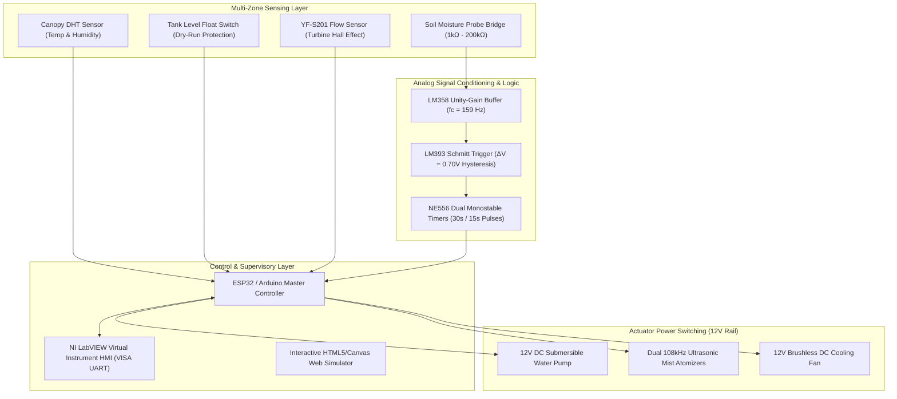

# Smart Automatic Irrigation, Foliage Misting & Thermal Cooling System

<p align="center">
  
  
  
  
  
  
</p>

An autonomous multi-zone agricultural climate controller designed to manage root soil moisture, foliage canopy humidity, and microclimate air temperature. The platform supports hybrid tri-mode deployment: **National Instruments LabVIEW Virtual Instrument HMI**, **Microcontroller Mode (ESP32 / Arduino)**, and **Discrete Analog Hardware Mode (LM358 / LM393 / NE556)**.

---

## Table of Contents
- [Executive Summary](#executive-summary)
- [System Architecture](#system-architecture)
- [NI LabVIEW Master HMI](#ni-labview-master-hmi)
- [Control System Design & Transfer Functions](#control-system-design--transfer-functions)
- [Hardware Architecture & Bill of Materials](#hardware-architecture--bill-of-materials)
- [Repository Structure](#repository-structure)
- [Execution & Quick Start Guide](#execution--quick-start-guide)
  - [1. Interactive Web Simulator](#1-interactive-web-simulator)
  - [2. NI LabVIEW HMI & Virtual Instrument](#2-ni-labview-hmi--virtual-instrument)
  - [3. MATLAB & Simulink Dynamic Simulation](#3-matlab--simulink-dynamic-simulation)
  - [4. Arduino Firmware Deployment](#4-arduino-firmware-deployment)
- [Verification & Quality Assurance](#verification--quality-assurance)
- [Author & License](#author--license)

---

## Executive Summary

Agricultural precision environments often suffer from irregular watering cycles, pump dry-run burnouts, and microclimate heat stress. This project provides a robust, multi-layer climate and irrigation system engineered with:

1. **Hysteresis-Guarded Soil Irrigation**: Eliminates rapid ON/OFF relay chattering via Schmitt trigger hysteresis ($0.70\text{ V}$ window).
2. **Ultrasonic Foliage Canopy Misting**: Dual 108 kHz piezoelectric atomizers create micro-fine humidity mist without waterlogging soil.
3. **Microclimate Ventilation**: High-airflow DC cooling fans automatically engage during thermal spikes.
4. **Hardware Safety Interlocks**: Float switch dry-run protection immediately halts pumps when storage tanks are depleted, while Hall-effect turbine sensors monitor volumetric flow.

---

## System Architecture



---

## NI LabVIEW Master HMI

The primary supervisory interface runs on **National Instruments LabVIEW**, communicating via **NI VISA Serial Communication (115200 Baud)**:

* **Virtual Gauges & Thermometers**:
  - Root Soil Moisture Resistance Gauge ($1\text{ k}\Omega - 200\text{ k}\Omega$)
  - Foliage Canopy Relative Humidity Gauge ($10\% - 90\%\text{ RH}$)
  - Ambient Air Temperature Thermometer ($0^\circ\text{C} - 60^\circ\text{C}$)
  - Volumetric Flow Rate Meter ($\text{L/min}$)
* **Diagnostic Annunciator LEDs**:
  - Power Indicator, Dry Soil Demand, DC Water Pump, Cooling Fan, Mist Creators #1 & #2, and Tank Fault Lockout.
* **Control Switches**:
  - 3-Position Mode Switch (`AUTO`, `MANUAL`, `OFF`)
  - Direct actuator override toggle switches.
* **Real-Time Oscilloscope Waveforms**: Continuous multi-channel trend plots sampling sensor inputs and control signals at 10 Hz.

---

## Control System Design & Transfer Functions

### 1. Soil Moisture Divider Bridge
$$V_{\text{sensor}}(t) = V_{CC} \cdot \frac{R_{\text{soil}}(t)}{R_{\text{fixed}} + R_{\text{soil}}(t)}$$
Where $V_{CC} = 12.0\text{ V}$ and $R_{\text{fixed}} = 10.0\text{ k}\Omega$.

### 2. Active Buffer & RC Noise Filter
Configured with an LM358 operational amplifier ($K_{\text{buf}} = 1.0$) with an RC low-pass filter ($R_f = 10.0\text{ k}\Omega$, $C_f = 0.1\ \mu\text{F}$):
$$G_{\text{buf}}(s) = \frac{1}{\tau_{\text{filter}} s + 1} = \frac{1}{0.001 s + 1}, \quad f_c = \frac{1}{2\pi R_f C_f} = 159.15\text{ Hz}$$
Attenuates 50 Hz/60 Hz mains interference and transient voltage spikes.

### 3. Schmitt Trigger Comparator Hysteresis
Positive feedback resistor ($R_H = 100\text{ k}\Omega$) establishes upper and lower switching thresholds:
$$V_{\text{UTP}} = 2.85\text{ V DC}, \quad V_{\text{LTP}} = 2.15\text{ V DC}, \quad \Delta V_H = 0.70\text{ V}$$
Prevents relay coil chatter when sensor readings fluctuate near switching points.

### 4. Monostable Pulse Duration Timing
The NE556 dual timer regulates actuator duty cycles:
$$T_{\text{pulse}} = 1.1 \cdot R_{\text{timer}} \cdot C_{\text{timer}}$$
- **Soil Irrigation Pulse**: $R = 270\text{ k}\Omega$, $C = 100\ \mu\text{F} \implies T \approx 29.7\text{ s}$
- **Foliage Misting Pulse**: $R = 270\text{ k}\Omega$, $C = 47\ \mu\text{F} \implies T \approx 14.0\text{ s}$

---

## Hardware Architecture & Bill of Materials

| Ref | Component | Specification | Function |
|---|---|---|---|
| **MCU** | ESP32 DevKit V1 / Arduino Uno | 32-bit / 8-bit Microcontroller | Main acquisition, communication, and control |
| **HMI** | NI LabVIEW Virtual Instrument | NI VISA Serial (115200 Baud) | Remote telemetry dashboard & manual supervisory override |
| **S1** | Soil Moisture Probe | Resistive 2-Prong Stainless | Root zone soil moisture conductivity measurement |
| **S2** | DHT11 / DHT22 | Digital Temperature & Humidity | Foliage canopy atmospheric monitoring |
| **S3** | Float Switch | Magnetic Reed Switch | Storage tank empty level interlock (dry-run protection) |
| **S4** | YF-S201 | Hall-Effect Turbine Sensor | Volumetric flow rate & line blockage diagnostics |
| **IC1** | LM358 | Dual Operational Amplifier | Active voltage follower buffering & filtering |
| **IC2** | LM393 / LM339 | Dual / Quad Open-Collector Comparator | Schmitt trigger threshold comparison with hysteresis |
| **IC3** | NE556 | Dual Precision Monostable Timer | Hardware-timed watering and misting pulse generation |
| **ACT1** | 12V DC Pump | Submersible 3W Brushless Pump | Pressurized soil root zone irrigation delivery |
| **ACT2** | Ultrasonic Discs | 2x 108 kHz Piezo Ceramic Transducers | High-frequency droplet atomization for canopy leaves |
| **ACT3** | DC Fan | 12V 0.15A Brushless DC Blower | Greenhouse / canopy convective cooling |
| **PWR** | LM7812 / LM7805 | Linear Regulators + Flyback Diodes | Regulated power rails with reverse-EMF suppression |

---

## Repository Structure

```text
├── Arduino/
│   ├── logic/
│   │   └── logic.ino                # Production Arduino sketch (Sensor reading & LabVIEW UART link)
│   └── testing/
│       └── testing.ino              # Hardware component standalone test bench sketch
├── Documentation/
│   ├── Analog_Automatic_Irrigation_System_Project_Report.docx # Comprehensive engineering technical report
│   ├── Analog_Irrigation_Block_Diagram.png                    # Functional system block diagram
│   ├── circuit_schematic.png                                  # Full schematic diagram of analog circuitry
│   ├── HOW_TO_RUN.md                                          # Detailed software and hardware execution steps
│   └── PROJECT_HANDOVER.md                                    # Project handover notes & design documentation
├── LabView/
│   ├── control panel.vi             # Main LabVIEW Master HMI Dashboard
│   └── Analog Irigation System.vi   # Standalone LabVIEW simulation model
├── Simulink/
│   ├── Analog_Irrigation_System.slx # Simulink dynamic system block model
│   ├── create_irrigation_model.m    # MATLAB script programmatically generating the Simulink model
│   └── simulate_irrigation.m        # Standalone MATLAB numerical simulation script
├── Web_Simulator/
│   ├── index.html                   # Interactive browser-based simulation dashboard
│   ├── styles.css                   # Glassmorphic eco-industrial UI stylesheet
│   ├── app.js                       # Browser state machine, controls, and canvas oscilloscope
│   └── assets/                      # Schematics and UI visual assets
├── LICENSE                          # MIT License File
└── README.md                        # Master project documentation
```

---

## Execution & Quick Start Guide

### 1. Interactive Web Simulator
No installation required:
```bash
cd Web_Simulator
python -m http.server 8080
```
Open `http://localhost:8080` in your web browser. Interact with the sensor sliders to watch the Schmitt trigger comparator thresholds, NE556 pulse generators, and oscilloscope waveforms trigger in real time.

### 2. NI LabVIEW HMI & Virtual Instrument
1. Connect the Arduino/ESP32 via USB.
2. Open NI LabVIEW (2020 or later).
3. Open `LabView/control panel.vi`.
4. Select the matching serial COM port and click **Run** (`Ctrl + R`).

### 3. MATLAB & Simulink Dynamic Simulation
1. Launch MATLAB.
2. Change directory to the `Simulink` folder:
   ```matlab
   cd('Simulink')
   ```
3. Run the standalone numerical simulation:
   ```matlab
   simulate_irrigation
   ```
4. To inspect the visual block diagram model, generate and open:
   ```matlab
   create_irrigation_model
   open_system('Analog_Irrigation_System')
   ```

### 4. Arduino Firmware Deployment
1. Open Arduino IDE.
2. Install required libraries: `DHT sensor library` and `Adafruit Unified Sensor`.
3. Open `Arduino/logic/logic.ino`.
4. Select board (e.g. `Arduino Uno` or `ESP32 Dev Module`) and target COM port, then click **Upload**.

---

## Verification & Quality Assurance

- **Analog Circuit Validation**: Transfer functions for buffer cutoffs ($159.15\text{ Hz}$), hysteresis bands ($0.70\text{ V}$), and pulse timings ($30\text{ s} / 15\text{ s}$) verified against SPICE and mathematical models.
- **Simulink Validation**: `simulate_irrigation.m` executes without external toolbox requirements and validates plant response against stepped sensor disturbances.
- **Encoding & Integrity**: All documentation files sanitized to UTF-8 without legacy Windows-1252 corruption.

---

## Author & License

- **Developer**: Hitesh V S
- **GitHub**: [@Hitesh070](https://github.com/Hitesh070)
- **License**: Released under the [MIT License](LICENSE).
