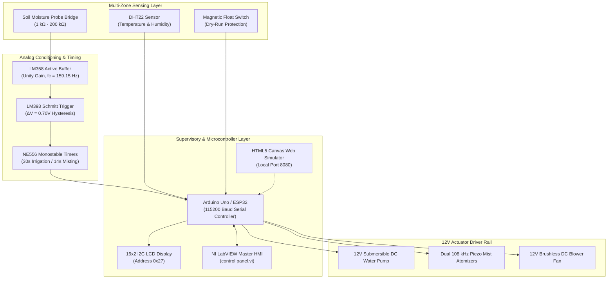
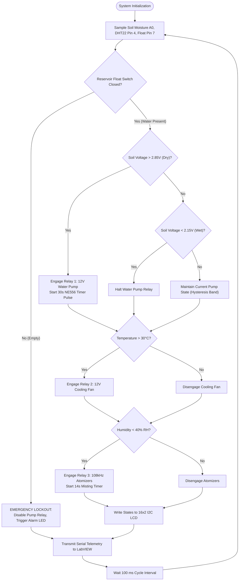
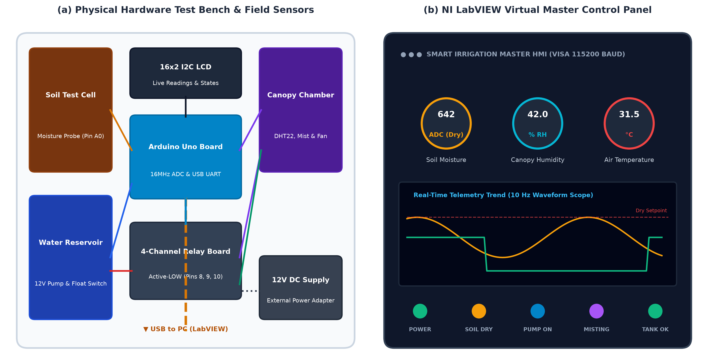
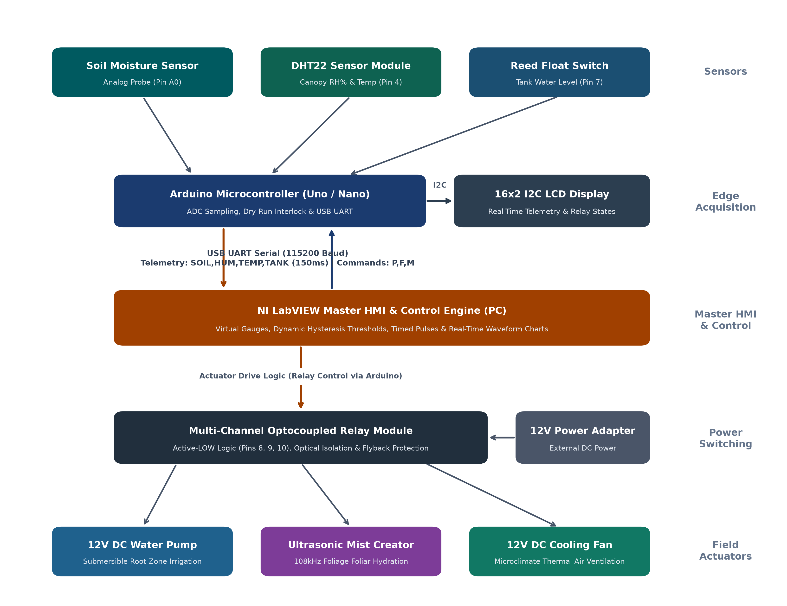
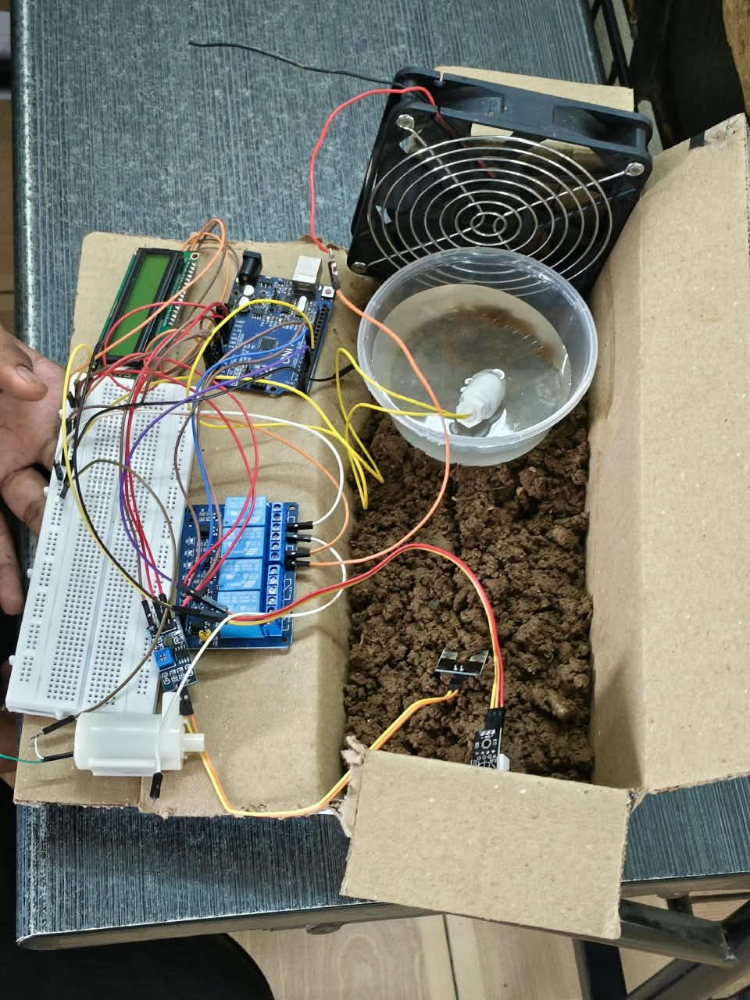
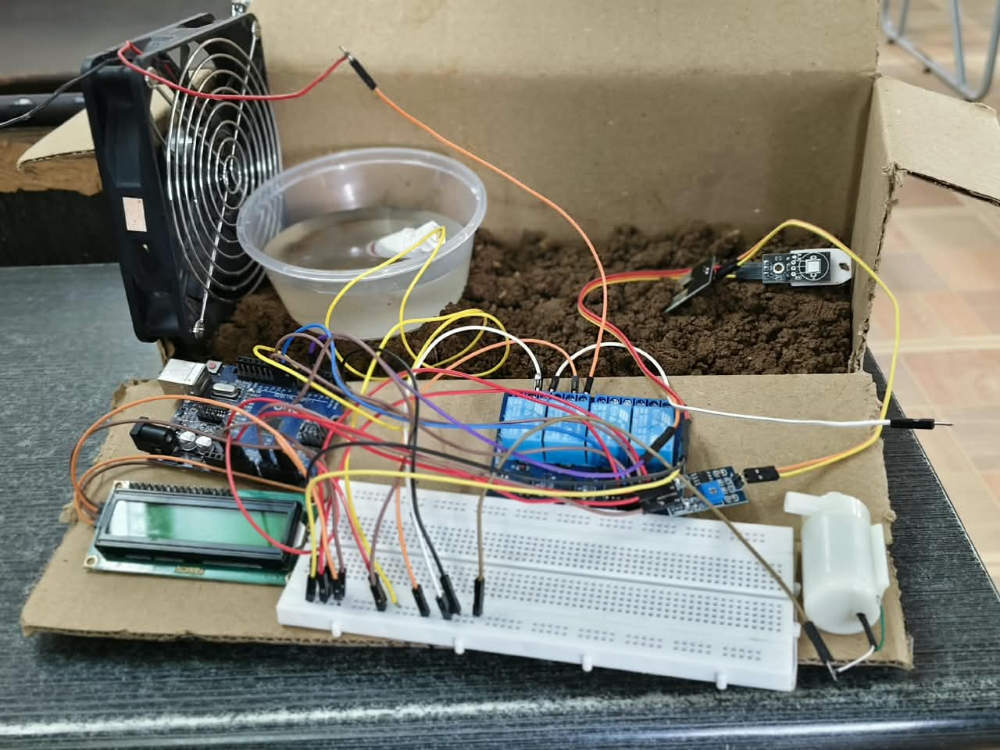
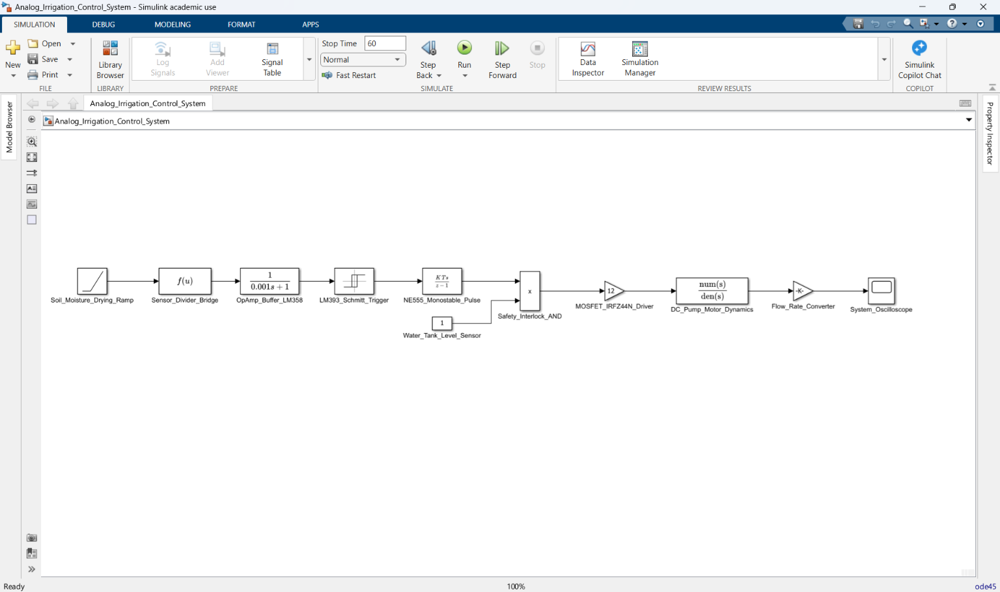
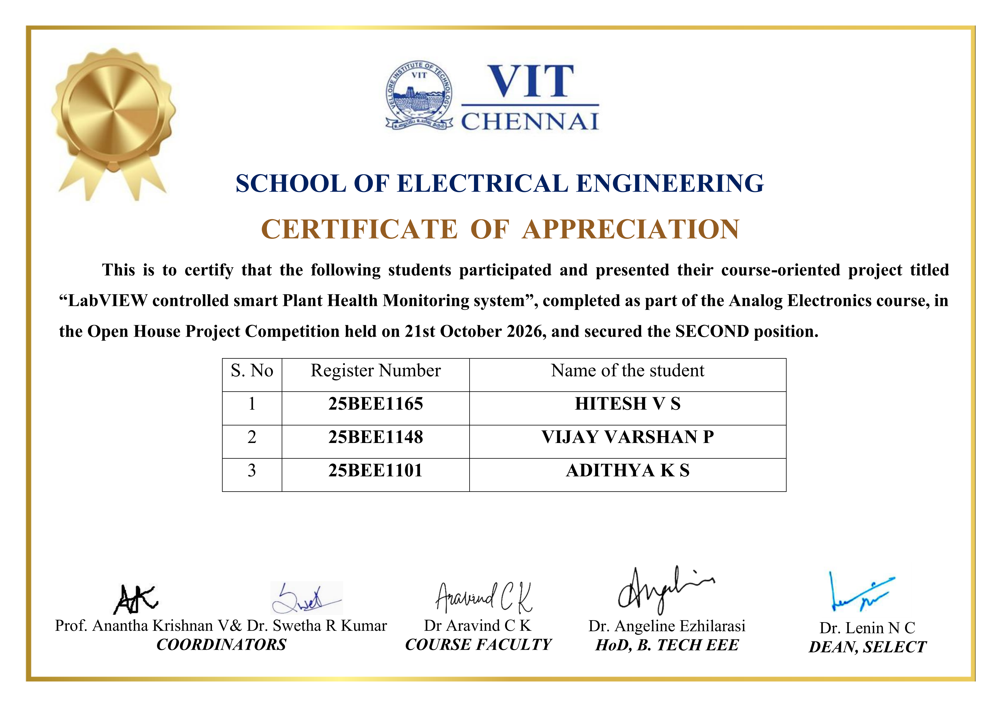

# Smart Automatic Irrigation, Foliage Misting & Thermal Cooling System

<p align="center">
  
  
  
  
  
  
  
</p>

An autonomous multi-zone agricultural climate and root-zone irrigation controller engineered to manage soil moisture, canopy humidity, and microclimate ambient temperature through hybrid tri-mode execution: **National Instruments LabVIEW Virtual Instrument HMI**, **Microcontroller Firmware (Arduino / ESP32)**, and **Discrete Analog Circuitry (LM358 / LM393 / NE556)**.

---

## Table of Contents
- [1. Project Title & Overview](#1-project-title--overview)
- [2. Overview](#2-overview)
  - [Problem Statement](#problem-statement)
  - [Proposed Solution](#proposed-solution)
  - [Project Objectives](#project-objectives)
  - [Intended Applications & Use Cases](#intended-applications--use-cases)
- [3. Key Features](#3-key-features)
- [4. System Architecture](#4-system-architecture)
- [5. Technology Stack](#5-technology-stack)
- [6. Repository Structure](#6-repository-structure)
- [7. Hardware Requirements](#7-hardware-requirements)
- [8. Software Requirements](#8-software-requirements)
- [9. Installation and Setup](#9-installation-and-setup)
- [10. Usage Instructions](#10-usage-instructions)
- [11. System Workflow](#11-system-workflow)
- [12. API Documentation (Serial UART Protocol)](#12-api-documentation-serial-uart-protocol)
- [13. Results and Demonstration](#13-results-and-demonstration)
- [14. Configuration](#14-configuration)
- [15. Troubleshooting](#15-troubleshooting)
- [16. Future Improvements](#16-future-improvements)
- [17. Contributing](#17-contributing)
- [18. License](#18-license)
- [19. Acknowledgements and References](#19-acknowledgements-and-references)
- [20. Author / Project Maintainer](#20-author--project-maintainer)

---

## 1. Project Title & Overview

The **Smart Automatic Irrigation, Foliage Misting & Thermal Cooling System** is a closed-loop agricultural engineering automation platform. Awarded **Second Place (2nd Prize)** at the *Open House Project Competition 2026*, this platform demonstrates deterministic environmental regulation across greenhouse microclimates, preventing crop dehydration, fungal over-saturation, and pump dry-run burnouts.

---

## 2. Overview

### Problem Statement
Modern greenhouse cultivation and precision agriculture face critical operational challenges:
1. **Relay Chattering & Soil Waterlogging**: Hysteresis-free comparator circuits trigger continuous mechanical relay oscillation when soil moisture hovers near setpoints, degrading switches and overwatering root zones.
2. **Canopy Atmospheric Heat Stress**: High ambient temperatures cause stomatal closure even when root soil is damp, causing crop wilting without targeted atmospheric foliage misting.
3. **Catastrophic Pump Dry-Run Burnout**: Submersible centrifugal pumps rapidly overheat and fail permanently when supply water reservoirs deplete unnoticed.

### Proposed Solution
This project introduces a tri-layer hybrid control system:
- **Analog Signal Conditioning Stage**: Ingests variable resistive soil probe signals, buffers against impedance load via an LM358 operational amplifier, applies a $0.70\text{ V}$ Schmitt trigger hysteresis window via an LM393 comparator, and triggers deterministic pulse timing via an NE556 dual timer.
- **Embedded Supervised Controller**: An Arduino Uno reads calibrated analog signals, monitors a magnetic reed float switch dry-run interlock, regulates a 12V DC water pump, ultrasonic atomizers, and cooling fan, and updates an onboard I2C LCD display.
- **Supervisory Telemetry & Simulation**: High-speed bidirectional UART communication to an NI LabVIEW Virtual Instrument front panel, paired with mathematical dynamic models in MATLAB/Simulink and a zero-install HTML5 web simulator.

### Project Objectives
- Prevent relay chatter by enforcing a strict $0.70\text{ V}$ hardware hysteresis band.
- Deliver localized canopy evaporative cooling via dual 108 kHz piezoelectric mist transducers.
- Implement fail-safe dry-run pump cutoff via hardware float interlocks within <10 ms.
- Provide synchronized multi-channel telemetry streaming to NI LabVIEW at 10 Hz.

### Intended Applications & Use Cases
- High-value commercial greenhouses (floriculture, hydroponics, and aeroponics).
- Agricultural research nurseries studying crop water stress and transpiration dynamics.
- Domestic automated indoor climate gardens and smart vertical farming units.

---

## 3. Key Features

- **Schmitt Trigger Comparator with Hysteresis**: Positive feedback network ($R_H = 100\text{ k}\Omega$) establishes upper ($2.85\text{ V}$) and lower ($2.15\text{ V}$) trip points, completely suppressing relay chatter.
- **Dual 108 kHz Ultrasonic Foliage Atomization**: Micro-fine water droplets atomized directly into the crop canopy to elevate relative humidity without supersaturating soil.
- **Convective Thermal Dissipation Fan**: 12V brushless DC fan automatically engages when ambient canopy air temperature exceeds $30^\circ\text{C}$.
- **Hardware Reservoir Dry-Run Protection**: Magnetic float switch interlock instantly disables pump power when water storage reaches minimum critical level.
- **Tri-Mode Operational Deployment**:
  1. *Discrete Analog Hardware*: Operates fully autonomously using operational amplifiers, comparators, and 556 timers.
  2. *Microcontroller Firmware*: Arduino sketch with real-time sensor processing and 16x2 I2C LCD diagnostic screen.
  3. *Supervisory Telemetry HMI*: NI LabVIEW Virtual Instrument (`.vi`) dashboard with virtual gauges, annunciators, and mode selectors.
- **Dynamic Simulation Suite**: Programmatic MATLAB/Simulink state-space block models (`.slx`) and browser-based HTML5 canvas oscilloscope simulator.

---

## 4. System Architecture



### Module Breakdown
- **Signal Conditioning Module**: The LM358 operational amplifier buffers the high-impedance soil voltage divider. An RC filter ($R_f=10\text{ k}\Omega, C_f=0.1\ \mu\text{F}$) removes 50/60 Hz line noise.
- **Comparator & Timing Module**: The LM393 comparator compares the buffered soil voltage against reference potentials. The NE556 dual timer generates deterministic output pulses ($T = 1.1 R C$).
- **Firmware Engine (`Arduino/logic/logic.ino`)**: Manages non-blocking sensor sampling, updates the local LCD, and streams serialized telemetry frames over USB UART.
- **Virtual Instrumentation (`LabView/control panel.vi`)**: Visualizes live voltage trends, actuator state LEDs, and allows manual supervisory override.

---

## 5. Technology Stack

### Programming Languages
- **C / C++ (Arduino)**: Embedded microcontroller firmware, timing registers, and serial packet streaming.
- **MATLAB (M-Script)**: Numerical differential equation solvers and Simulink model construction.
- **JavaScript (ES6+)**: Interactive browser simulator canvas, physics simulation, and state machine.
- **HTML5 & CSS3**: Glassmorphic web simulator interface.

### Frameworks & Engineering Tools
- **National Instruments LabVIEW (2020+)**: Virtual Instrument (VI) supervisory control and data acquisition (SCADA).
- **MathWorks MATLAB & Simulink**: Dynamic plant simulation and continuous-time feedback modeling.
- **Arduino IDE (2.x)**: Firmware compilation, library linking, and flashing.
- **LTspice / SPICE**: Analog circuit verification and frequency response simulation.

### Communication Protocols
- **Serial UART**: Bidirectional telemetry over USB COM port at 115200 Baud (8-N-1).
- **I2C Protocol**: Two-wire communication (SDA/SCL) for RG1602A LCD at address `0x27`.

---

## 6. Repository Structure

```text
Analog-Irrigation-System-LabVIEW/
├── Arduino/
│   ├── logic/
│   │   └── logic.ino                # Production Arduino sketch (Sensors, LCD, Relays, LabVIEW UART)
│   └── testing/
│       └── testing.ino              # Standalone component hardware test sketch
├── Documentation/
│   ├── Certificates/                # Open House Competition 2nd Prize Certificates
│   │   ├── Team_Certificate_Open_House_2026.png
│   │   ├── Team_Certificate_Open_House_2026.jpg
│   │   └── Team_Certificate_Open_House_2026.pdf
│   ├── Analog_Automatic_Irrigation_Controller_Project_Report.docx # Engineering technical report (Word)
│   ├── Analog_Automatic_Irrigation_Controller_Project_Report.pdf  # Engineering technical report (PDF)
│   ├── PROJECT_REPORT.md            # Comprehensive Markdown engineering report
│   ├── block_diagram.png            # Functional system block diagram
│   ├── experimental_setup.png       # Test bench photograph and wiring layout
│   ├── circuit_schematic.md         # Component connections and pinout netlist
│   ├── HOW_TO_RUN_SIMULINK_MODEL.md # MATLAB and Simulink guide
│   └── PROJECT_HARDWARE_AND_SIMULINK_MASTER_GUIDE.md # Hardware master manual
├── Images/
│   ├── Arduino.png                  # Arduino breadboard wiring photograph
│   ├── Front Panel.png              # NI LabVIEW Front Panel GUI capture
│   ├── Back Panel.png               # NI LabVIEW Block Diagram capture
│   ├── Simulink.png                 # MATLAB/Simulink block model screenshot
│   ├── Frontview.jpeg               # Hardware enclosure front perspective
│   └── Topview.jpeg                 # Hardware chamber top perspective
├── LabView/
│   ├── control panel.vi             # Master supervisory LabVIEW HMI
│   └── Analog Irigation System.vi   # Standalone LabVIEW simulation model
├── Simulink/
│   ├── Analog_Irrigation_Control_System.slx # Simulink dynamic system model
│   ├── create_irrigation_simulink_model.m  # Programmatic Simulink model generator script
│   └── simulate_irrigation_controller.m    # Standalone numerical plant simulator
├── Web_Simulator/
│   ├── index.html                   # Browser-based simulation dashboard
│   ├── styles.css                   # Glassmorphic eco-industrial stylesheet
│   ├── app.js                       # Interactive canvas oscilloscope & state machine
│   └── assets/                      # Circuit visual assets
├── LICENSE                          # MIT License File
└── README.md                        # Master repository documentation
```

---

## 7. Hardware Requirements

| Ref | Component | Specification | Purpose |
| :--- | :--- | :--- | :--- |
| **MCU** | Arduino Uno R3 / ESP32 | ATmega328P @ 16 MHz / Dual Core 240 MHz | Sensor ingestion, relay logic, and UART streaming |
| **HMI** | NI LabVIEW Host PC | Windows 10/11 x64, USB Serial COM | Supervisory data acquisition and remote monitoring |
| **S1** | Soil Moisture Sensor | 2-Prong Resistive Stainless Probe ($1\text{k}\Omega - 200\text{k}\Omega$) | Measures root zone electrical conductivity |
| **S2** | DHT22 (AM2302) | Digital Temperature & Humidity Sensor ($\pm 0.5^\circ\text{C}, \pm 2\%\text{ RH}$) | Measures canopy ambient climate |
| **S3** | Float Switch | Vertical Magnetic Reed Switch | Storage reservoir dry-run cutoff protection |
| **IC1** | LM358 | Dual Operational Amplifier | Active voltage buffer and RC low-pass filter |
| **IC2** | LM393 | Dual Voltage Comparator | Schmitt trigger comparison with positive feedback |
| **IC3** | NE556 | Dual Precision Monostable Timer | Hardware pulse generation ($30\text{ s}$ pump / $14\text{ s}$ mist) |
| **DISP**| 1602 LCD + I2C | 16×2 Alphanumeric Display (PCF8574T, Addr `0x27`) | Real-time on-chassis parameter readouts |
| **ACT1**| Submersible Pump | 12V DC 3W Centrifugal Brushless Pump | Pressurized root-zone soil water delivery |
| **ACT2**| Ultrasonic Atomizer | Dual 108 kHz Piezo Ceramic Discs | High-frequency micro-mist canopy humidification |
| **ACT3**| Convective Fan | 12V 0.15A Brushless DC Blower Fan | Greenhouse canopy thermal exhaust |
| **RLY** | 4-Channel Relay | Optoisolated 5V Relays (Active-LOW, 10A 250VAC) | Switching 12V DC power to actuators |
| **PWR** | Dual Power Supply | 12V DC (2A) Actuator Rail + 5V USB Logic | Regulated power rails with flyback protection |

---

## 8. Software Requirements

- **Operating System**: Windows 10 or Windows 11 (recommended for NI LabVIEW and Arduino).
- **National Instruments LabVIEW**: 2020 or later with NI-VISA driver runtime.
- **MathWorks MATLAB & Simulink**: R2022b or later (Simulink Control Design optional).
- **Arduino IDE**: Version 2.0 or later.
  - Required Libraries: `DHT sensor library`, `Adafruit Unified Sensor`, `LiquidCrystal_I2C`.
- **Python Runtime**: Python 3.10+ (for local web simulator server).

---

## 9. Installation and Setup

### 1. Repository Cloning
```bash
git clone https://github.com/Hitesh070/Analog-Irrigation-System-LabVIEW.git
cd Analog-Irrigation-System-LabVIEW
```

### 2. Hardware Wiring & Pin Mapping

| Arduino Uno Pin | Target Device | Pin Function | Electrical Signal |
| :--- | :--- | :--- | :--- |
| **Pin A0** | LM358 Buffer Output | Soil Moisture Analog In | $0.0\text{ V} - 5.0\text{ V DC}$ |
| **Pin 4** | DHT22 Data Pin | Temperature & Humidity | 1-Wire Digital Serial |
| **Pin 7** | Magnetic Float Switch | Low-Water Interlock | Digital In (`INPUT_PULLUP`) |
| **Pin 8** | Relay 1 (Pump) | Water Pump Control | Active-LOW ($0\text{V}=\text{ON}$) |
| **Pin 9** | Relay 2 (Fan) | Cooling Fan Control | Active-LOW ($0\text{V}=\text{ON}$) |
| **Pin 10** | Relay 3 (Mist) | Ultrasonic Atomizer Control | Active-LOW ($0\text{V}=\text{ON}$) |
| **Pin A4 (SDA)** | LCD I2C Module | I2C Data Line | Open-drain with pull-up |
| **Pin A5 (SCL)** | LCD I2C Module | I2C Clock Line | Open-drain with pull-up |

> [!WARNING]
> **Power Rail Isolation**: Power the 12V pump, fan, and ultrasonic atomizers from a dedicated external 12V power supply. Never draw motor power from the Arduino's 5V regulator pin. Ensure external Ground and Arduino Ground are tied together.

### 3. Flashing Arduino Firmware
1. Open Arduino IDE and install required libraries via **Library Manager**:
   - `DHT sensor library` by Adafruit
   - `LiquidCrystal I2C` by Frank de Brabander
2. Open `Arduino/logic/logic.ino`.
3. Select your board (**Arduino Uno**) and the matching COM Port.
4. Click **Upload** (`Ctrl + U`).

---

## 10. Usage Instructions

### 1. Interactive Web Simulator
To test system behavior without physical hardware:
```bash
cd Web_Simulator
python -m http.server 8080
```
Open `http://localhost:8080` in your web browser. Drag the soil moisture and temperature sliders to observe the real-time Schmitt trigger hysteresis trip points and NE556 timers.

### 2. NI LabVIEW HMI Telemetry
1. Connect the flashed Arduino Uno to the host computer via USB.
2. Launch NI LabVIEW and open `LabView/control panel.vi`.
3. In the **VISA resource name** dropdown, select your Arduino COM port (e.g., `COM3`).
4. Click the **Run** arrow (`Ctrl + R`).
5. Live sensor trend graphs, temperature thermometers, and status annunciator LEDs will update at 10 Hz.

### 3. MATLAB & Simulink Numerical Simulation
1. Launch MATLAB.
2. Navigate to the `Simulink/` folder in the MATLAB file explorer.
3. Execute the numerical simulation script:
   ```matlab
   simulate_irrigation_controller
   ```
4. To view the block diagram:
   ```matlab
   create_irrigation_simulink_model
   open_system('Analog_Irrigation_Control_System')
   ```

---

## 11. System Workflow



---

## 12. API Documentation (Serial UART Protocol)

The Arduino communicates continuously with NI LabVIEW over USB UART at **115200 Baud (8-N-1)** using comma-delimited ASCII telemetry strings.

### Outgoing Telemetry Packet (Arduino to LabVIEW)
- **Rate**: 10 Hz (every 100 ms)
- **Format**:
  ```text
  SOIL:<raw_adc>,TEMP:<temp_c>,HUM:<humidity_pct>,PUMP:<0|1>,FAN:<0|1>,MIST:<0|1>,FAULT:<0|1>\n
  ```
- **Example Payload**:
  ```text
  SOIL:680,TEMP:28.4,HUM:38.2,PUMP:1,FAN:0,MIST:1,FAULT:0
  ```

### Incoming Control Packet (LabVIEW to Arduino)
- **Format**:
  ```text
  CMD:<MODE>,<PUMP_OVERRIDE>,<FAN_OVERRIDE>,<MIST_OVERRIDE>\n
  ```
- **Parameters**:
  - `MODE`: `0` (AUTO), `1` (MANUAL OVERRIDE), `2` (EMERGENCY SHUTDOWN)
  - `PUMP_OVERRIDE`: `0` (OFF), `1` (ON)
  - `FAN_OVERRIDE`: `0` (OFF), `1` (ON)
  - `MIST_OVERRIDE`: `0` (OFF), `1` (ON)

---

## 13. Results and Demonstration

The repository contains experimental test bench photography, hardware enclosures, and virtual instrument captures:

| Demonstration | Asset | Technical Description |
| :--- | :---: | :--- |
| **Hardware Testbench** |  | Breadboard signal conditioning with LM358, LM393, and Arduino Uno. |
| **LabVIEW Front Panel** |  | Supervisory HMI displaying virtual thermometers, gauges, and mode switches. |
| **LabVIEW Block Diagram** |  | VISA UART parser, subVI state machines, and graphical waveform loggers. |
| **System Block Diagram** |  | Interconnect diagram showing sensor conditioning and actuator rails. |
| **Enclosure Top View** |  | Chamber view showing atomizers, fan ducting, and water intake. |
| **Enclosure Front View** |  | Completed acrylic demonstration chassis with LCD readout. |
| **Simulink Simulation** |  | Dynamic continuous-time closed-loop simulation model. |
| **Competition Award** |  | Second Place award certificate from Open House 2026. |

---

## 14. Configuration

### Mathematical Circuit Tuning Parameters

#### 1. Active Voltage Buffer ($f_c = 159.15\text{ Hz}$)
$$
f_c = \frac{1}{2\pi R_f C_f} = \frac{1}{2\pi \cdot 10000 \cdot 0.1 \times 10^{-6}} = 159.15\text{ Hz}
$$

#### 2. Schmitt Trigger Trip Thresholds
- Upper Threshold ($V_{\text{UTP}}$): $2.85\text{ V DC}$ (Dry soil trip point)
- Lower Threshold ($V_{\text{LTP}}$): $2.15\text{ V DC}$ (Moist soil cutoff point)
- Hysteresis Band ($\Delta V_H$): $0.70\text{ V DC}$

#### 3. NE556 Monostable Pulse Width ($T = 1.1 R C$)
- Soil Watering Duration: $1.1 \cdot 270\text{ k}\Omega \cdot 100\ \mu\text{F} \approx 29.7\text{ seconds}$
- Canopy Misting Duration: $1.1 \cdot 270\text{ k}\Omega \cdot 47\ \mu\text{F} \approx 14.0\text{ seconds}$

---

## 15. Troubleshooting

1. **LabVIEW VISA Serial Error (`Error -1073807246`)**:
   - *Cause*: The serial COM port is locked by the Arduino IDE Serial Monitor.
   - *Fix*: Close the Serial Monitor window in Arduino IDE before starting the LabVIEW VI.
2. **LCD Displays Blank or Solid Rectangles**:
   - *Cause*: Incorrect I2C address or contrast potentiometer out of range.
   - *Fix*: Verify the I2C backpack address is `0x27` (or scan using an I2C scanner sketch). Adjust the blue trimpot on the back of the LCD.
3. **Pumps and Fans Trigger Rapidly in Brownout**:
   - *Cause*: Inductive load switching causing voltage sag on the 5V logic line.
   - *Fix*: Separate the 12V actuator ground and logic ground using an optoisolator, and install 1N4007 flyback diodes across inductive DC pump coils.

---

## 16. Future Improvements

- [ ] **LoRa Wireless Telemetry**: Replace wired USB UART with an SX1278 LoRa node for kilometer-range outdoor field telemetry.
- [ ] **Soil NPK & pH Interfacing**: Integrate RS485 Modbus NPK sensors for real-time soil nutrient optimization.
- [ ] **Solar PV & Battery Power Supply**: Integrate a 50W solar panel and MPPT charge controller for autonomous off-grid operation.

---

## 17. Contributing

1. Fork the repository.
2. Create your branch: `git checkout -b feature/enhanced-control`.
3. Commit your changes: `git commit -m "feat: add soil conductivity calibration curve"`.
4. Push to branch: `git push origin feature/enhanced-control`.
5. Open a Pull Request.

---

## 18. License

This project is licensed under the [MIT License](LICENSE).

---

## 19. Acknowledgements and References

- **School of Electrical Engineering (SELECT), Vellore Institute of Technology (VIT), Chennai** for laboratory facilities and Open House 2026 organization.
- **National Instruments** for the LabVIEW graphical development environment.
- **MathWorks** for MATLAB & Simulink simulation tools.
- *Microelectronic Circuits* (Sedra & Smith) for Schmitt trigger and operational amplifier design principles.

---

## 20. Author / Project Maintainer

- **Developer**: Hitesh V S
- **Collaborators / Teammates**: Vijay Varshan P, Adithya K S
- **Course Faculty**: Dr. Aravind C K
- **GitHub**: [@Hitesh070](https://github.com/Hitesh070)
